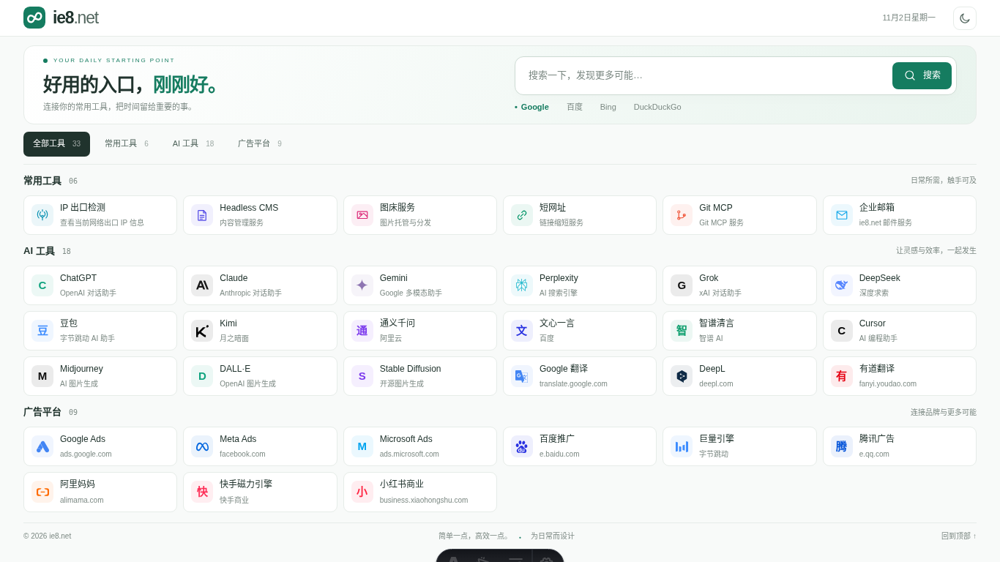
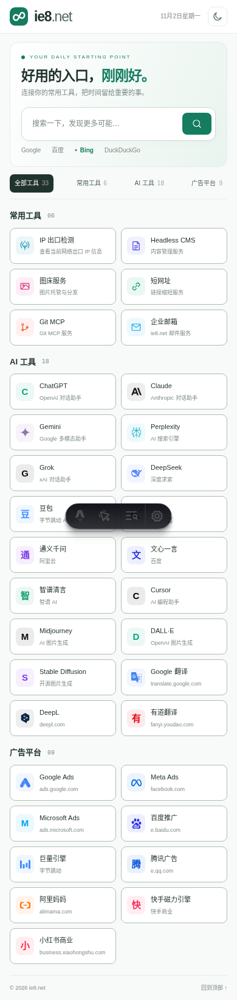
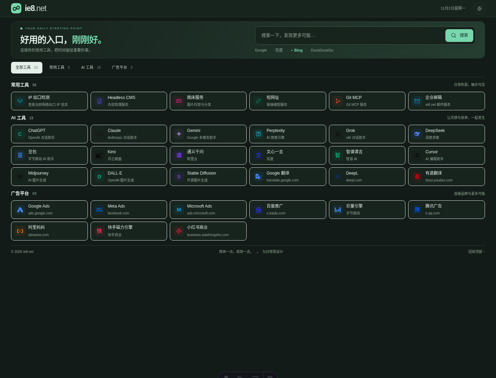

# ie8.net 页面与品牌重设计

薄荷绿与中性底色的简洁工作台，包含独立设计的 8 / 无限符号矢量标志。

- 移除左侧导航，使用顶部品牌栏与紧凑六列卡片；1366×768 桌面尺寸可一屏显示全部 33 个入口与页脚，手机保留双列布局、深浅色切换。
- 保留原有 33 个入口、搜索引擎偏好与最近访问记录。
- 新增分类筛选、`/` 聚焦搜索、服务图标与说明。
- 使用系统字体，无外部字体加载请求。
- Logo：`public/logo.svg`；网站图标：`public/favicon.svg`。

## 预览

## 验证

`npm run build`、`git diff --check` 通过。
Chromium 验证分类筛选、搜索快捷键、搜索引擎偏好持久化、深浅色切换、最近访问持久化；375、390、768、1024、1440px 宽度无横向溢出，无浏览器脚本错误。

本地运行：`npm ci`，然后 `npm run dev -- --background`。
